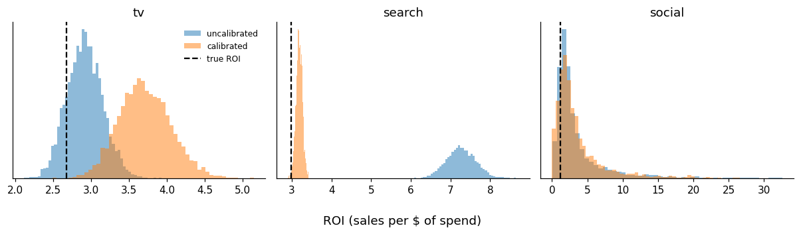

# Marketing Mix Modeling and Geo Experiments

Simulated marketing data with a known true return on each channel, used to check what a
Bayesian marketing mix model (MMM) gets right, where it fails, and how a randomized geo
holdout fixes it.

The simulated business spends on TV, search and social over three years of weekly data.
Sales also respond to an **unobserved demand shock**, and the search budget follows that
shock (search spend tracks query volume). That is the standard reason MMMs overstate the
return on search.

## Notebooks

| Notebook | What it does |
|---|---|
| [01_mmm_simulation](notebooks/01_mmm_simulation.ipynb) | Fits a Bayesian MMM in PyMC-Marketing (geometric adstock, logistic saturation) and compares the posterior ROI with the truth; refits under a different carryover prior to check prior sensitivity. |
| [02_geo_experiment](notebooks/02_geo_experiment.ipynb) | Turns search off in 10 of 40 randomly chosen geos for 7 weeks, estimates the lift with difference-in-differences (with an event study) and synthetic control (with placebo inference), and adds the result to the MMM as a lift-test likelihood. |
| [03_attribution](notebooks/03_attribution.ipynb) | Simulates 50,000 user journeys where purchase intent drives both search exposure and conversion, and compares first-touch, last-touch, linear, Markov-chain and Shapley attribution with true incremental conversions. |

## Main results

**ROI by channel** (posterior median and 90% interval; truth from the simulator):

| Channel | True ROI | MMM | MMM calibrated with geo test |
|---|---|---|---|
| TV | 2.68 | 2.91 (2.54–3.31) | 3.69 (3.17–4.28) |
| Search | 2.98 | 7.26 (6.67–7.88) | 3.19 (3.05–3.32) |
| Social | 1.20 | 2.22 (0.66–11.63) | 2.46 (0.48–11.47) |

- The uncalibrated MMM overstates search by a factor of about 2.4, because search spend has a
  0.85 correlation with the demand shock the model does not observe.
- The geo holdout recovers the true lift: −59.4 sales per week by DiD and −59.6 by synthetic
  control, against a true −60.3.
- Calibrating with the experiment brings search close to the truth, but the demand-driven
  variation then shifts to TV, the other channel whose budget follows demand. Each channel
  whose spend responds to demand needs its own test.
- In the attribution simulation, last touch gives search 56% of the credit against a true
  incremental share of 37%, and all methods hand out more than twice the conversions that
  the channels actually caused.



## Code

- `src/simulate.py`: geo-week data-generating process (adstock, saturation, demand shock,
  holdout design). The national series used by the MMM is the sum over geos.
- `src/attribution.py`: journey simulator, true incremental conversions, and the attribution
  methods.

## Running it

```
pip install -r requirements.txt
cd notebooks
jupyter lab
```

Run the notebooks in order (notebook 2 reads the uncalibrated ROI draws saved by notebook 1).
Sampling uses NumPyro's NUTS through PyMC (`nuts_sampler="numpyro"`); each MMM fit takes a
few minutes on a laptop CPU.

## References

- Blake, T., Nosko, C., & Tadelis, S. (2015). Consumer heterogeneity and paid search effectiveness: A large-scale field experiment. *Econometrica*, 83(1), 155–174.
- Gordon, B. R., Zettelmeyer, F., Bhargava, N., & Chapsky, D. (2019). A comparison of approaches to advertising measurement: Evidence from big field experiments at Facebook. *Marketing Science*, 38(2), 193–225.
- Jin, Y., Wang, Y., Sun, Y., Chan, D., & Koehler, J. (2017). Bayesian methods for media mix modeling with carryover and shape effects. Google Inc.
- Abadie, A., Diamond, A., & Hainmueller, J. (2010). Synthetic control methods for comparative case studies. *JASA*, 105(490), 493–505.

## License

MIT. See [LICENSE](LICENSE).
